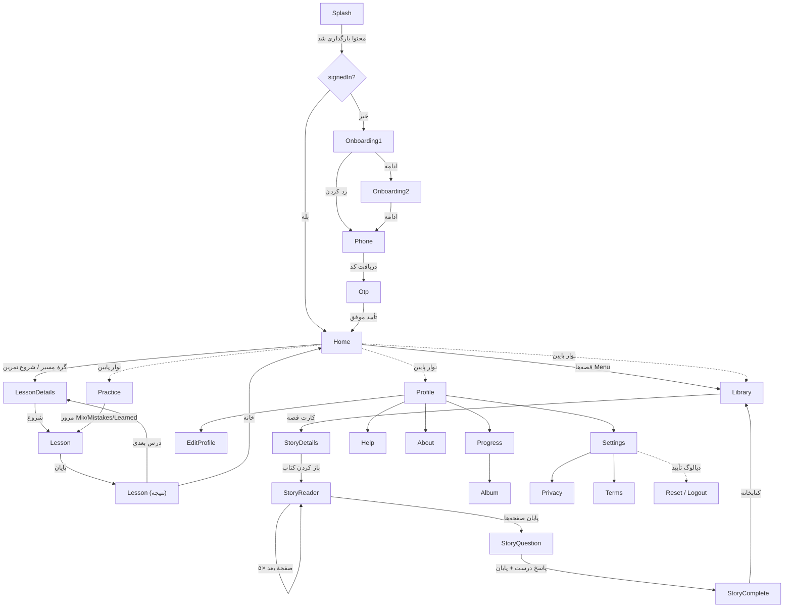

# AVA — سند UX Discovery و نقشه راه بازطراحی (فاز ۰۶۲)

**نسخه:** ۰٫۱ (پیش‌نویس برای بازبینی مالک) · **تاریخ:** ۲۰۲۶-۱۱-۰۷ · **شاخه:** `062-ux-discovery` (از `0bbc3bf`)
**روش:** ممیزی کد (`read in code`) + ران شبیه‌ساز Pixel_6a/API 35 با APK دیباگِ ران مجاز ۲۰۲۶-۱۱-۰۶ (`app-debug.apk` از `main b13e145`) + واکشی منابع مرجع در ۲۰۲۶-۱۱-۰۷.
**محدودیت صادقانه:** هیچ تغییر UI/Theme/Route/محتوایی در این فاز اعمال نشده است. هر عدد اندازه از کد خوانده شده، نه اندازه‌گیری فیزیکی؛ TalkBack و کودک واقعی آزموده نشده‌اند (بخش ۱۵).

---

## ۱. خلاصه اجرایی

AVA یک پایهٔ UX قوی و غیرمعمول دارد: لایهٔ کامپوننت مشترک بالفعل (`Components.kt`)، هدف لمس ۶۴/۷۲dp یکدست (۲۴ مورد ۶۴dp، CTAهای ۷۲dp)، بازخورد کهربایی به‌جای خطای قرمز (`AvaTheme.kt:32`)، `liveRegion` برای بازخورد، دیالوگ‌های تأیید امن با جایگاه درست در RTL، کاهش حرکت سیستم و درون‌اپ، و RTL واقعی. **کنتراست همهٔ جفت‌رنگ‌های متنی فعلی بالای ۴٫۵:۱ است (محاسبه‌شده از کد، کمترین ۴٫۷۷:۱).**

ممیزی، ده شکاف اصلی پیدا کرد که هیچ‌کدام ساختار را نمی‌شکنند:

| # | شکاف | شدت | شاهد |
|---|---|---|---|
| ۱ | Splash بلند و بی‌نشانگر پیشرفت روی شروع سرد (روی شبیه‌ساز ≥۱۳ ثانیه مشاهده شد) | P1 | `.zcode/screens/home.png`؛ `AuthScreens.kt:27-36` |
| ۲ | متن‌های توسعه در UI قابل‌انتشار (`mock_hint` در Phone/OTP) | P1 (مانع انتشار، خارج از این فاز) | `AuthScreens.kt:97,120`؛ UX-G09 |
| ۳ | دو کنترل صوت هم‌زمان در قصه‌خوان («شنیدن» + «توقف صدا») | P1 | `StoryScreens.kt:126-129`؛ screenshot `story-reader.png` |
| ۴ | پراکندگی شکل: ۱۰ شعاع گوشهٔ متمایز بدون مقیاس | P2 | شمارش grep از `ui/screens/*` |
| ۵ | پراکندگی نوار پیشرفت: ۵ ارتفاع متمایز (۴/۶/۷/۸/۹dp) | P2 | `HomeScreen.kt:54`، `StoryScreens.kt:68,92,118`، `ProfileScreens.kt:35,114`، `LessonScreens.kt:98` |
| ۶ | تایپوگرافی با وزن مصنوعی: فقط یک فایل فونت (`vazirmatn.ttf`)، Bold/SemiBold شبیه‌سازی می‌شوند | P2 | `res/font/`؛ `AvaTheme.kt:23` |
| ۷ | تصمیم دوبل (انتخاب ← «بررسی کن») برای کودک ۴ ساله هنوز آزمون‌نشده | P1 (تصمیم حفظ، نیازمند آزمون) | UX-G08؛ `LessonScreens.kt:113-116` |
| ۸ | همپوشانی IA پیشرفت: سه مقصد (Profile metrics، Progress، Album) با دادهٔ مشترک | P2 | `ProfileScreens.kt:38-50,97-133`؛ `AlbumScreen.kt:53` |
| ۹ | متن ثابت sp بزرگ (۷۶sp) روی نمونه در fontScale ۱٫۵ ریسک سرریز دارد (کاهش‌یافته با اسکرول و حالت compact) | P2 | `LessonScreens.kt:130`؛ ماتریس فونت در بخش ۱۲ |
| ۱۰ | Phone/OTP ماهیتاً کار بزرگسال‌اند؛ تناقض ساختاری برای کودک ۴–۷ سال | P1 (تصمیم فاز حساب واقعی) | UX_CONFORMANCE نکته‌های جانبی؛ `AuthScreens.kt` |

**جهت طراحی پیشنهادی (خلاصه):** «باغ زنده» — حفظ هویت سبز/کرم/کلاه‌برداریِ نرم موجود و حرفه‌ای‌تر کردن آن با: مقیاس توکن رسمی (رنگ/تایپ/فاصله/شکل/حرکت)، ارتقای لایهٔ `Components.kt` به دیزاین‌سیستم صریح، یک «صحنهٔ پیشرفت» منسجم به‌جای سه صفحهٔ هم‌پوشان، Splash هدفمند با نشانگر، و کنترل صوت حالت‌مند. هیچ rebrand یا پالت خارجی پیشنهاد نمی‌شود.

---

## ۲. وضعیت فعلی محصول و معماری (تأییدشده از کد)

- **پلتفرم:** Native Android، Kotlin + Jetpack Compose، `android/app`. نسخه ۰٫۶٫۱ (versionCode 16)، minSdk 26، targetSdk 35، `supportsRtl="true"` (`AndroidManifest.xml`).
- **گیت آخر:** `main` @ `2f67ba8`؛ فاز ۰۶۱ روی `061-native-toolchain-formal` @ `0bbc3bf` بسته شد: **۱۴۳ تست، ۰ شکست، ۰ خطا** (XMLهای ۲۰۲۶-۱۱-۰۷ ۲۰:۳۷، ۱۳ فایل)، `lintDebug` موفق، `audit-project.py` موفق، `sync --check` موفق. این فاز هر پنج مورد را دوباره تأیید کرد — بدون اختلاف.
- **Routeها:** ۲۳ مقدار متمایز در `Route` (`AvaViewModel.kt:13`)؛ `AvaApp.kt:60-82` آن‌ها را در **۲۲ شاخه** رندر می‌کند (Onboarding1/2 شاخهٔ مشترک). چهار ریشه: Home، Library، Practice، Profile (`AvaApp.kt:15`).
- **محتوا:** ۱ سطح، ۳ واحد، ۶ درس، ۱۷ فعالیت (۷ kind فعال در کاتالوگ)، ۲ قصه، ۹ صفحه؛ `approvedForRelease=false` (`design/content.fa.json`). هیچ محتوای تازه‌ای در این فاز ساخته نشده.
- **معماری UI:** صفحه‌ها فقط state/actions می‌گیرند (`AvaState`/`AvaActions`، `AvaApp.kt:18`)؛ I/O از Composable ممنوع و رعایت شده (audit `uiContentBoundary` سبز). ۱۲ kind فعالیت با registry/reducer (`ActivityRegistry`، `ExerciseReducer`).
- **هویت بصری موجود:** پالت سبز/کرم/کاغذی (`DesignTokens.kt`)، فونت Vazirmatn، ۱۶ تصویر محلی (صورتک آوا، خرگوش/روباه/سنجاب، باغ، لوگوی «اوا»)، زبان فارسی محاوره‌ای گرم.
- **CMS/Sync:** طبق ADR-0004 معوق؛ این سند هیچ نیازی به آن ندارد.

## ۳. ممیزی UX صفحه‌به‌صفحه

**روش:** هر ۲۲ شاخه از `AvaApp.kt` + لایهٔ کامپوننت خوانده شد. اسکرین‌شات شبیه‌ساز: Splash، Home (باغ کامل)، Library، فعالیت درس (بازی ۱ از ۳ + انتخاب + فیدبک «پیدایش کردی!»)، StoryDetails، StoryReader — همگی RTL درست و بدون crash در logcat. Profile/Practice/Settings/… با `uiautomator dump` (متن‌های واقعی صفحه) تأیید شدند؛ بررسی بصری عمیق آن فایل‌های PNG انجام نشد (NOT VERIFIED بصری، شواهد ساختاری کافی). نکتهٔ روش: jump مستقیم با `qa_route` در شروع سرد توسط خودِ Splash بازنویسی می‌شود (`MainActivity.kt:33` → `navigate`، سپس پیشروی Splash)؛ ضبط مطمئن فقط با ناوبری گرم و تپ واقعی ممکن بود.

### ۳٫۱ ماتریس صفحات (۱۴ پرسش مأموریت، خلاصه)

| صفحه (فایل) | هدف/کاربر اصلی | اقدام اصلی | مشخص در نگاه اول؟ | حالت‌ها | یافتهٔ اصلی |
|---|---|---|---|---|---|
| Splash (`AuthScreens.kt:27`) | انتظار کوتاه برند‌محور | خودکار | ✅ | فقط «در حال بارگذاری» | **F1:** بی‌نشانگر، بلند |
| Onboarding ۱/۲ (`AuthScreens.kt:37`) | آشنایی کودک/والد | «ادامه» ۷۲dp | ✅ | اسکرول در متن بزرگ | سالم؛ نقاط صفحه کوچک (۱۰dp، غیرقابل لمس — تزئینی، OK) |
| Phone (`AuthScreens.kt:71`) | بزرگسال (تلفن) | «دریافت کد» | ✅ | خطا با Feedback کهربایی، consent با Role.Checkbox | **F2:** mock_hint؛ کار بزرگسال |
| Otp (`AuthScreens.kt:102`) | بزرگسال | «تأیید» | ✅ | قفل/تایمر/ارسال مجدد، جعبه‌های LTR مستندشده | همان F2 |
| Home/باغ (`HomeScreen.kt`) | کودک | «شروع/ادامه» ۷۲dp | ✅ | all_done، قفل، компакт | **F8/F9:** زیگزاگ مسیر؛ سه‌گانهٔ پیشرفت |
| LessonDetails (`LessonScreens.kt:54`) | کودک+والد | «شروع/ادامه/تکرار» | ✅ | resume | پیش‌نمایش ۴ مرحله خوب؛ در درس ۵تایی ردیف فشرده می‌شود |
| Lesson-سؤال (`LessonScreens.kt:90`) | کودک | «بررسی کن»→«ادامه» | ✅ | hint، skip پس از ۲ خطا، نتیجه | **F4/F7**؛ نمونه ۷۶sp |
| Lesson-نتیجه (`LessonScreens.kt:312`) | کودک | «درس بعدی» | ✅ | discovering، allDone، replay | جشن حداقلی (پاپ ۰٫۶s) |
| Library (`StoryScreens.kt:24`) | کودک | کارت قصه (≥۱۲۴dp) | ✅ | خوانده‌شده/در جریان/تازه + نوار پیشرفت | قوی؛ stateDescription دارد |
| StoryDetails (`StoryScreens.kt:76`) | کودک | «باز کردن کتاب» | ✅ | ادامه/بازخوانی | factها آیکون+متن؛ wrap دوخطی F-آیکون (جزئی) |
| StoryReader (`StoryScreens.kt:109`) | کودک | «صفحهٔ بعد» | ✅ | صفحهٔ قبل غیرفعال، narration خاموش توضیح‌داده‌شده | **F3:** دو دکمهٔ صوت |
| StoryQuestion (`StoryScreens.kt:141`) | کودک | «بررسی کن» | ✅ | feedback + بازگشت به قصه | نوار پیشرفت ۰٫۹ دستی (نمایشی) |
| StoryComplete (`StoryScreens.kt:184`) | کودک | «برگشت به کتابخانه» | ✅ | — | سالم |
| Practice (`PracticeScreen.kt`) | کودک | «مرور کوتاه» | ✅ | **خالی: کارت اختصاصی + CTA** | مثال خوب حالت خالی |
| Profile (`ProfileScreens.kt:26`) | کودک/والد | منو | ✅ | — | **F8** هم‌پوشانی با Progress |
| EditProfile (`ProfileScreens.kt:64`) | والد | «ذخیره» | ✅ | شمارندهٔ نام | آواتار ۲×۲ با RadioButton semantics ✓ |
| Progress (`ProfileScreens.kt:97`) | والد/کودک | «ادامهٔ مسیر» | ✅ | all_done | هفتهٔ گل (شکل نه فقط رنگ ✓) + نشان‌ها |
| Album (`AlbumScreen.kt`) | کودک | — (کشف) | ✅ | قفل با دلیل متنی | با Progress ادغام‌پذیر (F8) |
| Settings (`SettingsScreens.kt:40`) | والد | سه سوییچ | ✅ | stateDescription فارسی | reset/logout با دیالوگ امن ✓ |
| Help/About/Privacy/Terms (`SettingsScreens.kt:55`) | والد | — | ✅ | بنر «نسخهٔ توسعه» | F2 (حقوقی placeholder) |

### ۳٫۲ فهرست مشکلات با جزئیات

هر مورد: شدت / شاهد / علت / راه‌حل / آزمون.

**F1 — Splash بی‌نشانگر (P1).** شاهد: سه اسکرین‌شات شبیه‌ساز در ثانیه‌های ۳/۷/۱۳ پس از شروع سرد همگی Splash را نشان می‌دهند؛ کد فقط `splash_loading` را نشان می‌دهد (`AuthScreens.kt:27-36`). علت: انتظار برای بارگذاری محتوا در Splash بدون affordance پیشرفت (مقیاس کار در شبیه‌ساز سرد). راه‌حل: نشانه‌گر پیشرفت غیرقطعی ظریف + پالس نرم صورتک (حذف در reduced motion) + بررسی امکان کوتاه‌کردن انتظار واقعی. آزمون: زمان ادراکی با کودک؛ تست UI برای وجود نشانگر.

**F2 — متن توسعه در UI (P1، مانع انتشار — خارج از دامنهٔ بازطراحی صفحه‌ها).** `mock_hint` در Phone/OTP (`AuthScreens.kt:97,120`)، بنر «نسخهٔ توسعه» در صفحه‌های حقوقی (`SettingsScreens.kt:95-100`). طبق UX-G09 با آمدن سرویس واقعی حذف می‌شود (فاز حساب). بازطراحی باید متن جایگزین آماده کند، نه حذف زودهنگام.

**F3 — کنترل صوت حالت‌مند نیست (P1).** `StoryScreens.kt:126-129` همیشه هم «شنیدن» و هم «توقف صدا» را رندر می‌کند (اسکرین‌شات تأیید می‌کند). کودک نمی‌داند کدام فعال است. راه‌حل: یک دکمهٔ toggle حالت‌مند (پخش ← «توقف صدا»، سکون ← «شنیدن») با stateDescription. آزمون: تست UI دو حالت + کاهش حرکت بی‌اثر.

**F4 — پراکندگی Shape/Progress (P2).** ۱۰ شعاع متمایز (8/18/20/22/24/26/28/32/100/50%) و ۵ ارتفاع نوار پیشرفت (4/6/7/8/9dp). علت: رشد ارگانیک بدون مقیاس. راه‌حل: مقیاس شکل ۴پله (12/18/24/100-pill) + کامپوننت واحد `AvaProgress`. آزمون: sweep grep در گیت.

**F5 — وزن مصنوعی فونت (P2).** یک `vazirmatn.ttf`؛ `FontWeight.Bold` شبیه‌سازی می‌شود (`AvaTheme.kt:23`). راه‌حل: نسخهٔ Variable یا وزن‌های واقعی Vazirmatn (Medium/SemiBold/Bold) در scope دیزاین‌سیستم (R01) — فقط با فایل‌های رسمی Vazirmatn، بدون asset خارجی.

**F6 — قصه‌خوان/درس: دو-لمسی بودن تصمیم (P1، تصمیم حفظ‌شده).** «بررسی کن» سپس «ادامه» (`LessonScreens.kt:113-116`). طبق UX-G08 عمداً حفظ شده تا با آزمون کودک تغییر کند. بازطراحی آن را لمس نمی‌کند؛ فقط آزمون کودک می‌تواند.

**F7 — نمونهٔ ثابت ۷۶sp (P2).** `LessonScreens.kt:130` و `:152` و `:246` اعداد sp ثابت‌اند؛ در fontScale ۲٫۰ برای حرف کوتاه ~۱۵۲sp می‌شود (در چارچوب اسکرول می‌ماند اما ترکیب می‌شکند). راه‌حل: سقف با `LocalDensity.fontScale` محدود یا lineHeight تطبیقی. آزمون: تست رندر در ۱٫۵/۲٫۰ (تست فعلی فقط عرض/فونت ۱٫۰ را می‌سنجد).

**F8 — سه مقصد برای «پیشرفت» (P2).** Profile سه متریک + منو، Progress متریک+گل+نشان، Album کارت‌های کشف؛ هر سه از `learner` مشتق‌اند (`ProfileScreens.kt:38-50`، `:97-133`؛ `AlbumScreen.kt:53`). راه‌حل [judgement]: «صفحهٔ پیشرفت» واحد با تب/بخش (مسیر، گل‌ها، نشان‌ها، کشف‌ها) یا ادغام Album در Progress و حذف Route.Album از ناوبری اصلی (ID ثابت می‌ماند، فقط لینک‌ها). تصمیم مالک در بخش ۱۵.

**F9 — زیگزاگ مسیر (P2، [judgement]).** padding متناوب ۲۰dp (`HomeScreen.kt:63`) گره‌ها را یکی‌درمیان می‌کشد؛ برای «مسیر» معنا دارد اما ممکن است ترتیب را مبهم کند. آزمون: کودک گرهٔ بعدی را پیدا می‌کند؟ (UX-G07 هدفش همین بود و تأیید آزمون ندارد.)

**F10 — Phone/OTP کار بزرگسال (P1، تصمیم محصول).** کودک ۴–۷ ساله شماره تایپ نمی‌کند؛ این جریان ورود فعلاً mock است و با فاز حساب واقعی باید به PIN والد/لینک خانواده تبدیل شود. بازطراحی R12 فقط «پوسته» را تمیز می‌کند، نه مدل را.

**نقاط قوت ثبت‌شده (حفظ شوند):** بازخورد چندکاناله با liveRegion و صورتک آوا (`LessonScreens.kt:285-310`)؛ skip پس از دو خطا بدون جریمه؛ دیالوگ تأیید با CTA امن ۷۲dp و اسلات درست RTL (`AvaApp.kt:47-55`، اسکرین‌شات `story-details` مسیر خروج)؛ storage error بنر + retry (`AvaApp.kt:37-39`)؛ «شنیدن» همیشه با برچسب متنی (آیکون تنها ممنوع — رعایت)؛ هفتهٔ گل با شکل نه فقط رنگ (`ProfileScreens.kt:137-153`)؛ متن کمکی «یک گزینه را انتخاب کن.» قبل از انتخاب.

## ۴. نقشهٔ Route و Navigation (فعلی، از کد)

ملاحظات ناوبری: چهار ریشه با `SaveableStateHolder` وضعیت اسکرول را نگه می‌دارند (`AvaApp.kt:19,41`)؛ خروج از درس با دیالوگ تأیید (`AvaApp.kt:47-55`)؛ بن‌بست وجود ندارد (هر Page بازگشت دارد). شکاف ناوبری: از StoryComplete «درس بعدی» وجود ندارد (فقط کتابخانه) — [judgement] قابل‌قبول.

## ۵. مسیرهای کاربر (فعلی → پیشنهادی)

| # | مسیر | وضعیت فعلی | نقطهٔ سردرگمی | پیشنهاد |
|---|---|---|---|---|
| ۱ | شروع اولیه | Splash→Onboarding→Phone→OTP→Home | **F1** و F2 و F10 | Splash هدفمند؛ Onboarding دست‌نخورده |
| ۲ | بازگشت کاربر | Splash→Home | F1 | همان |
| ۳ | انتخاب مسیر/درس | Home: گرهٔ فعلی برجسته ۷۲dp | F9 [judgement] | حفظ + آزمون کودک |
| ۴ | جزئیات درس | هدف+پیش‌نمایش+شروع | ردیف پیش‌نمایش در درس‌های پرتعداد | سقف ۴ پیش‌نمایش + «و n بیشتر» |
| ۵ | انجام فعالیت | renderer به تفکیک interaction | F6/F7 | فقط توکن‌سازی از دیزاین‌سیستم |
| ۶ | بازخورد/نتیجه | بنر سبز/کهربایی + صورتک + ادامه | — | حفظ؛ فقط توکن |
| ۷ | ادامهٔ مسیر | نتیجه→درس بعدی | — | حفظ |
| ۸ | ورود به کتابخانه | تب یا Menu قصه‌ها | — | حفظ |
| ۹ | مطالعهٔ داستان | Details→Reader با resume | F3 | toggle صوت |
| ۱۰ | پرسش داستان | سؤال+گزینه‌ها+بازخورد | — | حفظ |
| ۱۱ | تکمیل داستان | Complete→کتابخانه | — | حفظ |
| ۱۲ | پیشرفت/پروفایل | سه مقصد هم‌پوشان | F8 | ادغام پیشنهادی (تصمیم مالک) |

## ۶. الگوبرداری از محصولات موفق (منابع واکشی‌شده ۲۰۲۶-۱۱-۰۷)

منابع: Duolingo ABC «how we teach» (abc.duolingo.com)، Khan Academy Kids صفحهٔ محصول + مقالهٔ Learning Path (khankids.zendesk.com/360048828572)، Lingokids Basic/Plus (help.lingokids.com 115005840745/115005650309). ادعاهای تبلیغاتی (مثل «هم‌ارز ۲ ماه مهدکودک») به‌عنوان شاهد اثربخشی به‌کار نرفته‌اند.

| الگوی مشاهده‌شده | مسئله‌ای که حل می‌کند | قابلیت استفاده در AVA | انطباق با هویت AVA | نباید کپی شود |
|---|---|---|---|---|
| ABC: درس ≤۵ دقیقه، قطعات کوچک | فرسودگی کودک | ۳–۶ مرحلهٔ فعلی حفظ شود؛ در بخش «قاعده ۳» ثبت | سازگار | انیمیشن‌های پرهیجان |
| ABC: ۹ سطح شروع + سرعت شخصی | تفاوت سطح کودکان | فعلاً ۱ سطح؛ برای آیندهٔ محتوا | سازگار | تعیین سطح با تست رسمی |
| ABC: داستان با پرسش میان‌داستان | خواندن فعال | AVA پرسش را **پایان** قصه می‌گذارد؛ آزمون پرسش میان‌داستان پس از تأیید متخصص | سازگار | محتوای انگلیسی |
| ABC: آفلاین کامل | خانه‌های بی‌اینترنت | AVA از قبل آفلاین است (بدون INTERNET permission) | مزیت رقابتی AVA | — |
| Khan Kids: دکمهٔ بزرگ Play → مسیر | شروع بی‌تردید | CTA «شروع تمرین» ۷۲dp همین نقش را دارد؛ حفظ | سازگار | چرخش موضوعات متعدد |
| Khan Kids: مسیر خودکار + تسلط | تصمیم‌گیری کم برای کودک | AVA مسیر خطی قفل‌شده دارد؛ هم‌راستا | سازگار | پیشنهاد داده‌محور (نیازمند داده) |
| Khan Kids: ۵ شخصیت راهنما | دلبستگی و راهنمایی | آوا + ۳ دوست موجود؛ حضور هدفمندتر (F: آوا در سؤال حاضر نیست) | سازگار | شخصیت‌های برند دیگر |
| Lingokids: خوراک روزانه/بازی محبوب | تنوع | خارج از scope v1 (نیازمند محتوا) | — | قفل پولی |
| Lingokids: جدایی تجربه کودک/والد (Parents Area) | تمرکز کودک | AVA: تنظیمات/پیشرفت با Menu والد-پسند؛ پیشنهاد ناحیهٔ والد روشن‌تر (بدون gate در v1 طبق G06) | سازگار | اشتراک/پروفایل چندکودکه |
| هر سه: پیشرفت قابل‌فهم برای والد | اعتماد والد | ادغام F8 به «صفحهٔ پیشرفت» واحد | سازگار | اعداد XP/streak (ممنوع در AVA) |

## ۷. منشور UX اختصاصی AVA (۱۰ اصل + معیار پذیرش)

| # | اصل | معیار پذیرش قابل‌آزمون |
|---|---|---|
| ۱ | یک اقدام اصلی روشن | هر صفحه دقیقاً یک `Primary` فعال؛ grep per-screen در گیت R01 |
| ۲ | پیچیدگی تدریجی | هیچ صفحهٔ کودک بیش از یک سطح ناوبری فرعی؛ اطلاعات والد در Profile/Settings |
| ۳ | بازخورد فوری و غیرسرزنش‌گر | بازخورد ≤۱ فریم پس از check؛ هرگز رنگ قرمز/متن تنبیهی؛ liveRegion برای TalkBack |
| ۴ | حس پیشرفت واقعی | هر عدد پیشرفت از `learner` واقعی مشتق شود؛ هیچ عدد نمایشی دستی (YAGNI) |
| ۵ | شخصیت‌های هدفمند | حضور آوا فقط در بازخورد/نتایج/راهنما؛ هرگز روی گزینه‌ها یا CTA |
| ۶ | ثبات الگوها | دکمه/کارت/نوار پیشرفت فقط از دیزاین‌سیستم؛ دو پیاده‌سازی برای یک الگو ممنوع |
| ۷ | تفکیک کودک/والد | صفحات ریشه فقط کودک؛ مسیر والد حداکثر ۲ تپ از منو؛ برچسب روشن |
| ۸ | بازی‌سازی مسئولانه | بدون تایمر فشار، بدون lives، بدون اعلان؛ جشن ≤۴ ثانیه قابل‌رد و حذف در reduced motion |
| ۹ | طراحی برای محتوای واقعی | هر mockup با ۶ درس/۱۷ فعالیت/۲ قصه واقعی رندر می‌شود؛ بدون lorem/placeholder |
| ۱۰ | دسترس‌پذیری از ابتدا | ۶۴/۷۲dp، کنتراست ≥۴٫۵، semantics کامل، RTL واقعی، فونت ۱٫۵ سالم — در معیار پذیرش هر صفحه |

## ۸. جهت طراحی پیشنهادی — «باغ زنده»

هویت موجود (کاغذ نعنایی، کرم، evergreen، صورتک‌های محلی) درست است و **حفظ** می‌شود؛ حرفه‌ای‌سازی با پنج حرکت:

1. **سیستم صریح** — توکن‌های `DesignTokens.kt` به مقیاس کامل (رنگ/تایپ/فاصله/شکل/ارتفاع/حرکت) تبدیل می‌شوند و `Components.kt` به دیزاین‌سیستم رسمی ارتقا می‌یابد (R01). همهٔ ۱۰ شعاع پراکنده به ۴ پله می‌رسند.
2. **باغ به‌عنوان صحنهٔ پیشرفت** — Home می‌ماند؛ مسیر گره‌محور با برجسته‌سازی قوی‌تر گرهٔ فعلی (حلقهٔ فعلی خوب است؛ نشانهٔ حرکت نرم می‌گیرد — reduced-motion safe).
3. **صدا حالت‌مند** — toggle واحد شنیدن/توقف در قصه‌خوان و فعالیت‌ها (F3).
4. **پیشرفت یک‌جا** — «صفحهٔ پیشرفت» واحد: مسیر + هفتهٔ گل + نشان‌ها + کشف‌ها (تصمیم F8 با مالک).
5. **جشن باوقار** — پایان درس/قصه با یک لحظهٔ آوا + کارت کشف (≤۴s، قابل‌رد، بدون reduced-motion)؛ بدون confetti سنگین.

ممنوع همیشه: چرخش برند، پالت خارجی، فونت دیگر، شلوغی تبلیغاتی، عدد/ستاره/استریک.

## ۹. Design Tokens پیشنهادی (مبنا: مقادیر فعلی کد، نه سلیقه)

### ۹٫۱ رنگ — فعلی + کنتراست محاسبه‌شده (WCAG 2.2 AA)

| توکن | مقدار فعلی | مصرف | کنتراست (fg روی bg) | تصمیم |
|---|---|---|---|---|
| `paper` | `0xFFEDF6F2` | پس‌زمینه | ink ۱۰٫۴۲:۱ | حفظ |
| `surface` | `0xFFFBFDF8` | کارت روشن | ink ۱۱٫۲۱:۱ | حفظ |
| `cream` | `0xFFFEF7E1` | کارت اصلی/نوار پایین | ink ۱۰٫۷۱:۱ | حفظ |
| `evergreen` (primary) | `0xFF14766A` | CTA/انتخاب | روی سفید ۵٫۴۸:۱، روی cream ۵٫۱۲:۱ | حفظ |
| `evergreen_deep` | `0xFF0A5C54` | متن تأکید | روی paper ۷٫۱۴:۱ | حفظ |
| `ink` | `0xFF233D47` | متن اصلی | — | حفظ |
| `text_soft` | `0xFF395965` | متن ثانویه | روی cream ۷٫۰۳:۱ | حفظ |
| `muted` | `0xFF526C71` | متن کم‌رنگ | روی paper ۵٫۰۹:۱ | حفظ |
| `amber`/`amber_tint`/`amber_text` | `E3900F`/`FDEEC9`/`8A4F00` | خطا/هشدار (بدون قرمز) | ۵٫۷۰:۱ | حفظ — قاعدهٔ «بدون خطای قرمز» |
| `line` | `0xFFC7DDD2` | حاشیه/انتخاب‌پس‌زمینه | تزئینی | حفظ |
| `disabled_bg/text` | `E3DECF`/`625F50` | غیرفعال | ۴٫۷۷:۱ | حفظ (معاف از AA) |
| `plum`/`apricot`/`berry` | `7954B5`/`FFBD59`/`7C3457` | **بی‌مصرف در UI فعلی** | — | حذف از توکن عمومی یا ثبت «رزرو محتوا» |

پیشنهاد افزودن: `success` (همان evergreen_deep برای تیک)، `selected_ring` (=evergreen)، `scrim` (پردهٔ دیالوگ)، `focus` (حلقهٔ فوکوس TalkBack ≥۳:۱ روی paper) — همه از رنگ‌های موجود مشتق، بدون رنگ تازه.

### ۹٫۲ تایپوگرافی (Vazirmatn؛ فعلی → پیشنهادی)

| نقش | فعلی (`AvaTheme.kt:37-40`) | پیشنهاد | مصرف |
|---|---|---|---|
| Display | — (ندارد) | 40/Bold/1.4 | فقط صفحهٔ نتیجه/جشن |
| Headline | 32/28/24 Bold | 30/26/24 Bold (h=1.55) | عنوان‌های بزرگ |
| Title | 22/18/16 SemiBold-Medium | بدون تغییر | عنوان کارت |
| Body | 17/16/14 (h=1.7) | بدون تغییر؛ h=1.7 برای فارسی حفظ شود | متن |
| Label/Button | 18 SemiBold/14/12 | 18 SemiBold برای دکمه (مطالعهٔ ۷۲dp) | دکمه/برچسب |
| نشانهٔ درس | 76/48sp ثابت | 72/44sp با سقف fontScale ۱٫۳ روی خود نشانه | TargetCard |

پیشنهاد ساختاری: وزن‌های واقعی Vazirmatn (Medium/SemiBold/Bold) جایگزین faux-bold (F5).

### ۹٫۳ فاصله/شکل/ارتفاع

- **Spacing (فعلی پراکنده 4/6/7/8/10/12/16/18/20/24):** مقیاس ۸ پایه: 4, 8, 12, 16, 20, 24, 32, 40. حاشیهٔ صفحه ۲۰ (۱۶ compact) — حفظ.
- **Shape:** `small=12` (فکت‌ها)، `medium=18` (توکن/آیکون‌باکس)، `large=24` (کارت ثانویه)، `xlarge=32` (SoftCard/گره)، `pill=100` (دکمه/حباب). همهٔ ۱۰ مقدار فعلی به این ۵ نگاشت می‌شوند.
- **Elevation:** فعلی 0–6 پراکنده (SoftCard 1، کارت قصه 3، sheet OTP 6). پیشنهاد: level0=0، card=1، raised=3، sheet=6 — سه پله، بدون سایهٔ سنگین (clay نرم از حاشیه/رنگ می‌آید نه سایه).
- **آیکون:** 24dp داخل دکمه‌های متنی، 22dp فکت‌ها، همیشه با برچسب متنی؛ outline Material فعلی حفظ.

### ۹٫۴ حرکت (Motion)

| الگو | مدت/منحنی | reduced motion |
|---|---|---|
| فشار دکمه (scale .98) | 150ms tween (فعال `Components.kt:50`) | بدون حرکت (فعلاً 0ms) — حفظ |
| ورود بازخورد | fade+slide 200ms، یک‌بار | سوییچ آنی |
| پاپ کارت کشف | 600ms (فعال `AlbumScreen.kt:34`) | 0ms (فعلاً حفظ) |
| شناوری حباب | 2600ms+500n (فعال `LessonScreens.kt:190`)، ±6dp | ثابت (فعلاً حفظ) |
| جشن پایان | ≤۴s، یک‌بار، قابل‌رد | حذف |
| نوار پیشرفت | animateFloatAsState 300ms | سوییچ آنی |

قاعده: هیچ انیمیشن بی‌پایان جز شناوری حباب (و آن هم فقط با reduced-motion). `LocalReducedMotion` و پایش `ANIMATOR_DURATION_SCALE≤0.5` (`AvaApp.kt:17-28`) مرجع واحد بماند.

### ۹٫۵ تصویر و آیکون

۱۶ asset محلی (`design/assets.manifest.json`) کافی و باکیفیت‌اند. قواعد: تصویر هرگز روی متن انتخاب/CTA نمی‌افتد؛ آیکون بدون برچسب فقط در نوار پایین (با label) و تیک‌های وضعیت (با stateDescription)؛ هیچ آیکون تازه‌ای از بستهٔ خارجی اضافه نشود مگر با ADR.

## ۱۰. معماری کامپوننت‌های مشترک (موجود → هدف)

`Components.kt` همین امروز ستون فقرات است. مشخصات هدف (بدون پیاده‌سازی در این فاز):

| کامپوننت | وضعیت | مشخصات هدف (توکن‌ها/حالت‌ها/semantics) | محل استفاده | نباید برای |
|---|---|---|---|---|
| `Primary` | ✅ موجود | ۷۲dp/pill/evergreen؛ busy؛ disabled جفت‌رنگ اختصاصی؛ press .98 | CTA هر صفحه | انتخاب گزینه |
| `Secondary` | ✅ | ۶۴dp/24/outline سبز | اقدام فرعی | CTA اصلی |
| `SoftCard` | ✅ | 32/xlarge/cream، shadow 1 | ظرف محتوا | لیست لمسی بلند |
| `Header`/`Page` | ✅ | بازگشت ۶۴dp AutoMirrored + heading() | هر صفحهٔ غیر ریشه | ریشه‌ها |
| `Menu` | ✅ | سطر ۲۲→large | منوهای Profile/Settings | اقدام تخریبی بدون confirm |
| `Feedback` | ✅ | amberTint/liveRegion | خطا/اطلاع | موفقیت (سبز جدا) |
| `AvaProgress` | **جدید** | نوار واحد ۸dp + برچسب «n از m» فارسی؛ جایش ۵ ارتفاع فعلی | درس/قصه/پروفایل | حلقه‌های تزئینی |
| `ChoiceTile` | **جدید** | تجمیع `LessonChoice`/`SceneTile`/`BubbleChoice`/`StoryChoice` (۴ پیاده‌سازی هم‌خانوادهٔ فعلی)؛ ۶۴dp+، selected=حلقه ۳dp+radio؛ Role.RadioButton | همهٔ انتخاب‌ها | چیز دیگر |
| `AudioToggle` | **جدید** | حالت‌مند شنیدن/توقف (F3)؛ حالت خاموش با توضیح | قصه‌خوان/لایستن | — |
| `PathNode` | **جدید** | استخراج از `HomeScreen.kt:56-71`؛ سه وضعیت با semantics desc | Home | — |
| `StoryCard` | **جدید** | استخراج از `StoryScreens.kt:27-74` (۲ چیدمان compact/roomy) | Library | — |
| `MetricCard`/`BadgeCard`/`DiscoveryRow` | ✅/جدید | ادغام `ProfileMetric`/`ProgressMetric` | Progress/Album | — |
| `EmptyState` | **جدید** | الگوی `empty_practice` (`PracticeScreen.kt:28-30`) تعمیم | همه | خطا (Feedback) |
| دیالوگ‌ها | ✅ | `AlertDialog` با confirm=۷۲dp فیلد در اسلات اصلی | exit/reset/logout/legal/notice | منطق والد gate |

## ۱۱. Backlog بازطراحی صفحه‌به‌صفحه (فازهای اجرایی)

ترتیب بر اساس وابستگی (دیزاین‌سیستم ← صفحات پرمسیر ← بقیه). هر صفحه یک مأموریت مستقل؛ هیچ برشی بیش از یک صفحه/خانواده.

| شناسه | فاز | محدوده | وابستگی | فایل‌های احتمالی | معیار پذیرش (خلاصه) | Gate |
|---|---|---|---|---|---|---|
| R01 | توکن‌ها + کامپوننت‌های پایه | `DesignTokens`/`AvaTheme`/`Components` + `ChoiceTile`/`AvaProgress`/`AudioToggle` | — | همان فایل‌ها + تست‌ها | صفر radius خارج مقیاس؛ ۶۴/۷۲ حفظ؛ کنتراست ≥۴٫۵ محاسبه‌شده؛ ۱۴۳ تست سبز + تست‌های تازه | audit + gradle gate |
| R02 | Home و مسیر | `HomeScreen` + `PathNode` | R01 | `HomeScreen.kt` | گرهٔ فعلی واضح‌تر؛ بدون تغییر رفتار openLesson؛ ۳۲۰/۴۱۲ + فونت ۱٫۵ | همان |
| R03 | LessonDetails | `LessonDetailsScreen` | R01 | `LessonScreens.kt` | پیش‌نمایش سقف‌دار؛ resume واضح | همان |
| R04 | جریان فعالیت | rendererهای ۱۲ kind با `ChoiceTile`/`AudioToggle` | R01 | `LessonScreens.kt` | رفتار reducer دست‌نخورده؛ فونت ۱٫۵/۲٫۰ بدون بریدگی | همان |
| R05 | نتیجه/تکمیل | `LessonResultScreen` + جشن باوقار | R01 | `LessonScreens.kt` | جشن ≤۴s قابل‌رد؛ reduced-motion حذف | همان |
| R06 | Library | `StoryCard` | R01 | `StoryScreens.kt` | سه وضعیت حفظ؛ target ≥۱۲۴dp | همان |
| R07 | StoryDetails/Reader | + `AudioToggle` | R01,R06 | `StoryScreens.kt` | یک دکمهٔ صوت حالت‌مند | همان |
| R08 | پرسش/پایان قصه | `StoryQuestion/Complete` | R01 | `StoryScreens.kt` | نوار پیشرفت واقعی‌نما حذف/اصلاح | همان |
| R09 | Practice | حالت خالی/سه جلسه | R01 | `PracticeScreen.kt` | حفظ planner؛ فقط پوسته | همان |
| R10 | Progress + Album (تصمیم F8) | ادغام پیشنهادی | R01 | `ProfileScreens.kt`/`AlbumScreen.kt` | اگر ادغام: Route.Album فقط با لینک داخلی (ID محتوایی تغییر نمی‌کند) | همان + تأیید مالک |
| R11 | Profile/EditProfile | MetricCard واحد | R01 | `ProfileScreens.kt` | آواتار ۲×۲ حفظ | همان |
| R12 | Onboarding/Auth (پوسته) | بدون تغییر مدل ورود | R01 | `AuthScreens.kt` | mock_hint دست نمی‌خورد (فاز حساب) | همان |
| R13 | Settings/Info | Preference/FAQ | R01 | `SettingsScreens.kt` | reset/logout با دیالوگ امن حفظ | همان |

### Wireframe متنی — صفحه‌های کلیدی (نمونه)

**Home (باغ):** `[Scene bg.garden full-bleed]` ← ردیف بالایی: لوگو (۴۸/۶۴) | کارت سلام + «n از m مرحله» | آواتار-دکمه ۶۴ → کارت قهرمان: عنوان قدم بعد + تصویر آوا (72/104) + **Primary «شروع/ادامه»** → کارت «مسیر نشانه‌ها»: نوار ۸dp + گره‌ها: [فعلی ۷۲dp حلقه ۳dp کرم] [انجام‌شده ۴۸ تیک] [قفل کم‌رنگ] با indentation متناوب ۲۰dp → Menu «قصه‌ها» → نوار پایین (باغ|قصه‌ها|مرور|من).

**Lesson (سؤال):** Header(عنوان درس، back) ← «بازی n از m» + `AvaProgress` ۸dp ← ناحیهٔ اسکرول: نمونه (کرم، ۷۲sp‌سقف‌دار + شنیدن) / گزینه‌ها (`ChoiceTile` عمودی در compact؛ افقی فقط تک‌حرفی) ← بنر بازخورد (سبز تیک+آوا / کهربایی تلاش دوباره) ← **Primary بررسی کن/ادامه** (غیرفعال با helper) + Secondary رد کردن (پس از دو خطا).

**StoryReader:** Header(عنوان، back) ← «صفحهٔ n از ۵» + `AvaProgress` ← تصویر آوا-خوان + کارت متن صفحه ← `AudioToggle` (یک دکمه) ← **Primary صفحهٔ بعد** + TextButton صفحهٔ قبل (غیرفعال در صفحهٔ ۱).

**Library:** Page(باغ قصه‌ها) ← `StoryCard`×n: جلد ۹۶/۱۰۴ + عنوان + وضعیت pill + نوار پیشرفت (در جریان) → نوار پایین.

## ۱۲. چک‌لیست دسترس‌پذیری (معیار طراحی و آزمون)

| حوزه | معیار | وضعیت فعلی (شاهد) | آزمون آینده |
|---|---|---|---|
| هدف لمس | ۴۸dp حداقل Android؛ ۶۴ کودک؛ ۷۲ CTA | ✅ ۲۴×heightIn(64)، ۲×72؛ `NativeUiTest` ۶۴dp | assertion + دستگاه |
| فاصلهٔ لمسی | ≥۸dp بین اهداف نزدیک | ✅ spacedBy ≥۸ در گروه‌ها | تست ۳۲۰dp |
| کنتراست متن | ≥۴٫۵ (بزرگ ۳٫۰) | ✅ محاسبه‌شده بخش ۹٫۱ | ابزار scanner روی دستگاه |
| وضعیت با رنگ تنها | ممنوع | ✅ radio/tick/lock icon + border + stateDescription | TalkBack + نگاه |
| RTL | LayoutDirection واقعی | ✅ `supportsRtl`؛ فقط OTP/Phone با Ltr مستندشده (`AuthScreens.kt:142`) | دستگاه فارسی |
| فونت بزرگ | ۱٫۰/۱٫۳/۱٫۵ (۲٫۰ در ماتریس مأموریت) | ⚠️ compact در >1.15 (`LayoutThresholds` + fontScale checks در همهٔ صفحه‌ها)؛ رندر ۱٫۵/۲٫۰ NOT VERIFIED | تست رندر + دستگاه |
| TalkBack | ترتیب/برچسب/liveRegion | ⚠️ در کد رعایت (heading/stateDescription/liveRegion/Role)؛ دستگاه NOT VERIFIED | QA دستگاه (۰۸۰) |
| reduced motion | سیستم + درون‌اپ | ✅ `AvaApp.kt:17-28` | تست تنظیم سیستم |
| Wide/compact | 320/360/390/412 | ✅ `WidthsUiTest` 360/412؛ 320 جزئی در تست‌های تعامل | گسترش تست |
| OTP/Phone | استثنای بزرگسال با توضیح | ✅ contentType + Ltr مستند | — |

## ۱۳. QA و Acceptance Criteria (سراسری)

1. هر برش: `testDebugUnitTest` + `lintDebug` سبز با فلگ‌های شناخته‌شدهٔ ماشین (`_JAVA_OPTIONS=-Djava.net.preferIPv4Stack=true`، robolectric-deps، in-process) — بدون assemble/bundle.
2. `audit-project.py` و `sync --check` سبز.
3. تست UI تازه برای هر الگوی تازه (`ChoiceTile` حالت‌ها، `AudioToggle` دو حالت، `AvaProgress` برچسب).
4. رفتار سنجش‌شده تغییر نکند: reducer/planner/planner keys بدون تغییر؛ snapshot v2 دست‌نخورده.
5. RTL: هیچ `Modifier.padding(start/end)` دستی بدون دلیل RTL؛ تست ۳۶۰dp.
6. بدون permission/dependency تازه؛ بدون asset خارجی؛ بدون تغییر ID محتوا.
7. هر برش: ورودی WORKLOG + به‌روزرسانی PROGRESS_FA/NATIVE_VERIFICATION فقط با نتیجهٔ واقعی.

## ۱۴. وابستگی‌ها و ریسک‌ها

- **به فاز ۰۶۱:** گیت سبز ۱۴۳/۰ پایهٔ اطمینان بازطراحی است؛ هر برش باید آن را حفظ کند.
- **به محتوا:** هیچ بازطراحی نیازمند محتوای تازه نیست؛ «پرسش میان‌داستان» الگوی ABC فقط با تأیید متخصص آموزش (human gate) قابل ورود است.
- **ریسک رگرسیون UI:** تست‌های ۱۴۳گانه جریان فعلی را می‌شناسند (دو-لمسی، متن‌ها). R04/R07 بیشترین برخورد را دارند — تغییر متن رشته‌ها = به‌روزرسانی تست، هم‌زمان.
- **ریسک فونت:** افزودن وزن واقعی Vazirmatn باید با فایل رسمی و بدون تغییر متریک متن انجام شود وگرنه reflow رخ می‌دهد.
- **ریسک F8:** ادغام Album/Progress مسیر Route.Album را تغییر می‌دهد — تصمیم مالک لازم؛ IDهای محتوا مستقل‌اند.
- **زنجیرهٔ صوت:** `AudioToggle` باید با `AndroidNarrator` حالت‌های PlayedLocal/PlayedFallback/Missing هم‌خوان بماند (کد صوت این فاز لمس نمی‌شود).

## ۱۵. تصمیم‌های حل‌نشده — نیازمند تأیید مالک

1. **F8:** ادغام Progress+Album در یک صفحهٔ پیشرفت (پیشنهاد: بله) یا حفظ دو مقصد؟
2. **F9:** حفظ زیگزاگ مسیر Home یا مسیر عمودی منظم؟ (توصیه: حفظ + آزمون کودک)
3. **F5:** خرید وزن‌های واقعی فونت (فایل رسمی Vazirmatn، بدون هزینهٔ لایسنس — OFL) در R01؟
4. **ترتیب R02…R13** پس از R01 — پیشنهاد همین ترتیب است؛ تأیید مالک برای شروع R02.
5. **جشن پایان درس (R05):** سطح جشن حداقلی فعلی حفظ شود یا لحظهٔ آوا-انیمیت اضافه شود (نیازمند تصمیم، بدون asset تازه)؟
6. **آزمون با کودک:** چه زمانی (پس از R02/R04؟) و با چه پروتکلی — پیش‌نیاز هر تغییر رفتاری (F6).

## ۱۶. برنامهٔ اجرای فازهای بعدی

1. **تأیید این سند** توسط مالک + پاسخ ۶ تصمیم بخش ۱۵.
2. **R01 (دیزاین‌سیستم)** — تنها برش ساختاری؛ خروجی: توکن‌ها + ۵ کامپوننت پایه + تست؛ همهٔ ۱۴۳ تست موجود سبز می‌مانند.
3. برش‌های R02 تا R13 به ترتیب بخش ۱۱ — هر کدام: پیاده‌سازی + تست + گیت + WORKLOG + به‌روزرسانی اسناد وضعیت؛ هر برش حداکثر یک صفحه/خانواده.
4. پس از R04 و R07: ران شبیه‌ساز با فلوی واقعی (مثل همین ممیزی) + بازبینی بصری.
5. QA دستگاه/TalkBack به human gate `080-device-accessibility-qa` واگذار می‌شود.
6. CMS/Sync طبق ADR-0004 خارج از این نقشه‌اند.

---

## پیوست الف — شواهد این ممیزی

- اسکرین‌شات‌ها (untracked، `.zcode/screens/`): `home.png`(Splash در 13s)، `library.png`، `lesson-open.png`، `lesson-selected.png`، `lesson-feedback.png`، `story-details.png`، `story-reader.png`، `practice.png`/`profile.png` (تأیید محتوا با uiautomator dump)، ۹ صفحهٔ دیگر Splash-مانند در شروع سرد (محدودیت ابزار ضبط، نه محصول).
- ران شبیه‌ساز: `emulator-5554` (Pixel_6a API35)، نصب `app-debug.apk` (موجودی ران مجاز ۲۰۲۶-۱۱-۰۶ — هیچ build جدیدی انجام نشد)، logcat بدون AndroidRuntime برای `com.ava.reading`، دیالوگ تأیید خروج درس و فلوی کامل درس+قصه با تپ واقعی.
- واکشی وب ۲۰۲۶-۱۱-۰۷: ۵ منبع بخش ۶ (دو URL نخست با WebFetch خالی/خطا و سپس با reader کامل واکشی شد).
- محاسبهٔ کنتراست: اسکریپت luminance WCAG روی مقادیر `DesignTokens.kt` (بخش ۹٫۱).
- عدم دسترسی/انجام‌نشده: TalkBack، مقیاس فونت ۱٫۵/۲٫۰ رندر واقعی، بررسی بصری عمیق PNGهای Profile/Practice/Settings و ۴ صفحهٔ اطلاعات (متن‌ها با dump تأیید شد) — همگی NOT VERIFIED و به گیت‌های آینده واگذار شدند.
